<!-- Generated by scripts/build_cards.py from profile.json — edit profile.json, not this file. -->


  

  



<a href="https://github.com/Uzma-Niaz/n8n-Automation-Workflows">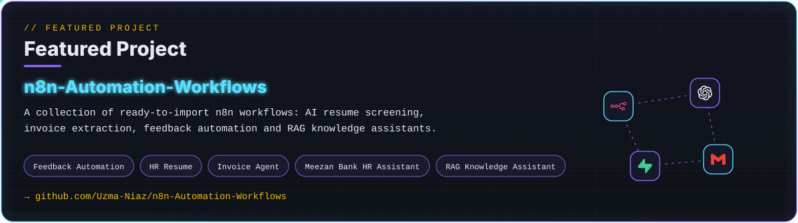</a>

<code>git clone https://github.com/Uzma-Niaz/n8n-Automation-Workflows.git</code>
 Then in n8n: Workflows → Import from File → pick any .json

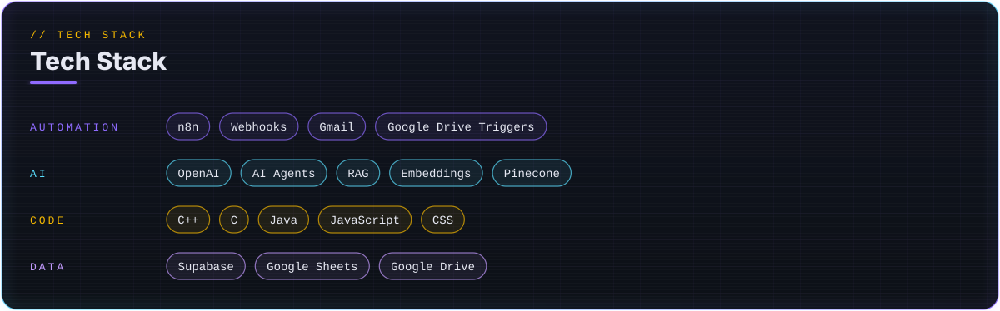


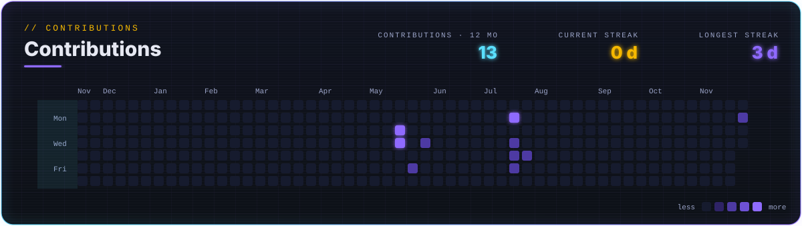

 


Dashboard refreshed daily from live GitHub data by a GitHub Action.

<i>“I've started talking to myself when debugging code. It's weird, but it works!”</i>

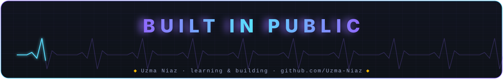

